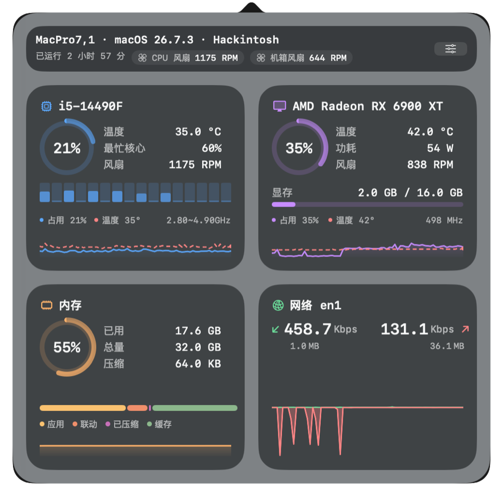
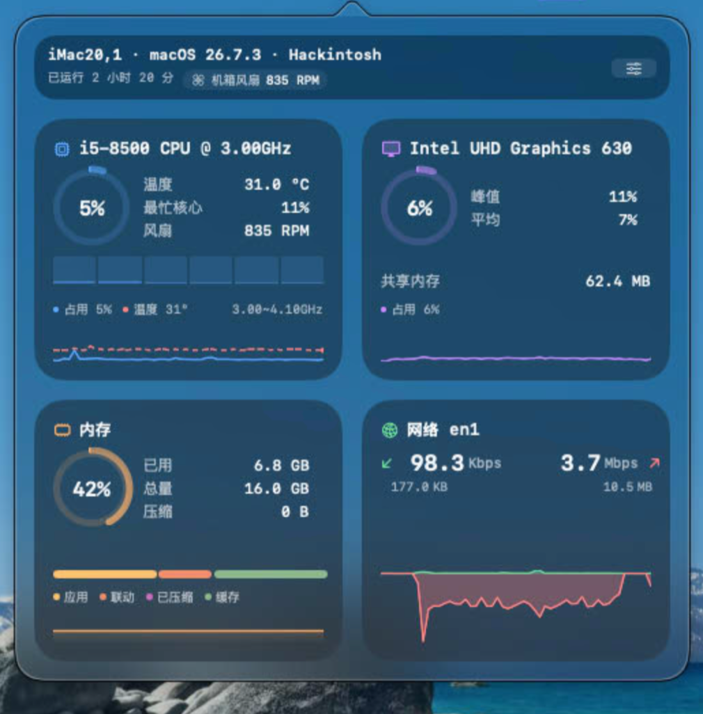

# GlassMonitor

macOS 26 菜单栏硬件监控，Liquid Glass 风格的弹出面板。为黑苹果与 Mac 设计，全部传感器数据无需 root 即可读取。



有独显的机器上，GPU 卡片显示温度、功耗、风扇、显存与频率；只有核显的机器会自动收起不存在的指标，改为显示共享内存与曲线窗口内的峰值/平均占用：



菜单栏读数按硬件域分组，温度与占用共用一个图标：


## 功能

- **菜单栏分组读数**：每个硬件域使用一个图标（CPU / GPU / 内存 / 网络），温度与占用靠单位区分（`°C` / `%`），可自由多选；数值使用等宽字体与固定宽度，读数变化时图标宽度不跳动。
- **无箭头玻璃面板**：点击菜单栏图标，面板从图标正下方展开，不画指向菜单栏的尖角；面板以非激活窗口出现，不抢当前 App 的键盘焦点。点击面板外的任意窗口或桌面、按 Esc、切换桌面、屏幕参数变化时都会自动收起。
- **中英双语**：自动跟随系统语言；也可在齿轮菜单的“语言”里选择跟随系统、简体中文或 English，切换后自动重启生效。
- **四张等宽等高玻璃卡片**：CPU、GPU、内存、网络按 2×2 网格排列，外框固定为 226×192 pt（英文界面加宽到 240×192），数据变化不会让某张卡变高或网格抖动。
- **顶部信息条**：只放卡片里没有的信息——机型、macOS 版本、开机时长，以及用户勾选的风扇实时转速（默认只显示在转的风扇）。
- **CPU**：总占用、每核心负载、温度、最忙核心、CPU 风扇转速、基础频率 ~ 最大睿频。风扇行固定显示为“风扇”，数值由 SMCSuperIO 自动识别：默认取 `CPUFAN`、没有则取水泵、再没有才用转速最高的在转通道；`CPUFAN` 读数为 0 或散热器接在别的接口时，可在齿轮菜单里手动指定哪一路作为 CPU 风扇。
- **GPU**：占用、温度、功耗、风扇、显存、核心/显存频率与实时曲线。每张卡任一时刻只显示一块 GPU 的真实数据；多 GPU 机器（例如 UHD 630 + RX 6900 XT）可在卡片标题处下拉切换，默认独显，各 GPU 的曲线历史独立保存，菜单栏同步跟随。核显没有独立风扇，也不发布独立功耗/频率通道；它的卡片改为显示共享内存占用和当前曲线窗口的峰值/平均占用，避免只剩一个空缺的温度。
- **内存**：压力、已用/总量、应用/联动/压缩/缓存构成、压缩率与交换空间。
- **网络**：上下行速率、会话累计流量、当前活动网卡与吞吐曲线。
- **偏好**：顶部风扇显示范围、CPU 卡片风扇通道、曲线窗口（1 / 3 / 5 分钟）、刷新间隔（1–5 秒）、显示每核心负载、开机自启（`SMAppService`，无需辅助进程或 root）。

## 本地化

界面文案使用 Apple 标准的 `.lproj` + `String(localized:)` 机制，放在：

- `Resources/en.lproj/Localizable.strings`
- `Resources/zh-Hans.lproj/Localizable.strings`
- 同目录的 `InfoPlist.strings` 负责本地化 App 名称

`Scripts/build.sh` 会把它们复制到 `Contents/Resources`。默认跟随系统语言，也可以使用齿轮菜单里的语言选项；显式选择会写入 App 自己的 `AppleLanguages`，与系统“按 App 设置语言”使用同一机制，然后自动重启（`Bundle.main` 只在进程启动时解析语言）。新增语言时复制一份 `.lproj`，并在 `Scripts/build.sh` 的 `CFBundleLocalizations` 中登记。

## 数据来源

| 指标 | 来源 |
| --- | --- |
| GPU 全部指标 | `IOAccelerator` → `PerformanceStatistics`（逐设备采样，不合并） |
| CPU 温度 / 风扇 | AppleSMC、SMCSuperIO `Sensors` 通道（CPUFAN / SYSFAN / AUXFAN…） |
| 内存与交换 | Mach `host_statistics64`、`sysctl vm.swapusage` |
| 网络 | `getifaddrs` 字节计数差分 |
| CPU 基础频率 / 睿频上限 | `sysctl hw.cpufrequency` 与固件 P-State 表 |

### 诚实的限制

- 应用不使用 root、不安装特权驱动，因此**无法读取 Intel CPU 的实时全核频率**（需要内核读 MSR）。CPU 卡片显示的是固件声明的基础频率与最大睿频区间，而不是实时值。
- **Intel 核显（UHD 630 等）在 macOS 下只发布占用与共享内存计数**：温度、功耗、核心频率和风扇都没有对应的 `PerformanceStatistics` 通道，SMC 里也通常没有 `TG0*` 温度键。面板因此不显示核显的功耗/风扇行（核显本来也没有风扇），只有 SMC 真的提供 GT 温度时才显示 GPU 温度；`gart*` 计数描述的是 GART 映射窗口，不会被当成显存占用展示。
- 实时核心频率、部分 SMC 键、某些主板的风扇通道是否可用，取决于机型、EFI 与已安装的 kext；缺失的传感器显示 `—`，不会伪造数值。
- 不使用任何模拟或占位数据，也不会把多块 GPU 的数据混在同一张卡里。

## 测试环境

以下截图来自两台黑苹果实机：

| 项目 | 独显机器 | 核显机器 |
| --- | --- | --- |
| 机型 | MacPro7,1（Hackintosh） | iMac20,1（Hackintosh） |
| CPU | Intel Core i5-14490F（6P / 16T） | Intel Core i5-8500（6C / 6T） |
| GPU | AMD Radeon RX 6900 XT 16 GB | Intel UHD Graphics 630 |
| 内存 | 32 GB | 16 GB |
| 系统 | macOS 26.7.3（25G342） | macOS 26.7.3（25G342） |

多 GPU 下拉切换在单 GPU 机器上通过注入第二块虚拟 GPU 验证了交互与数据隔离；独显与核显两种机器上的卡片显示已分别在上述两台机器上实机确认。

## 构建

需要 macOS 26 与 Xcode 26 Command Line Tools（Swift 6.2）。无需 Xcode 工程文件。

```bash
bash Scripts/build.sh release
open build/GlassMonitor.app
```

脚本会完成 release 构建、生成 `build/GlassMonitor.app`、复制 `Resources/*.lproj` 本地化资源、用 `Resources/AppIcon.png` 生成 `AppIcon.icns`，并进行 ad-hoc 签名。

诊断传感器可用：

```bash
swift run -c release sysdump
```

## 许可

[MIT](LICENSE)